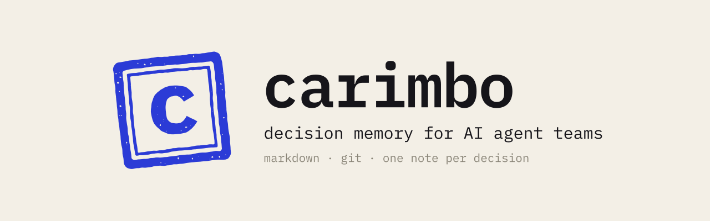
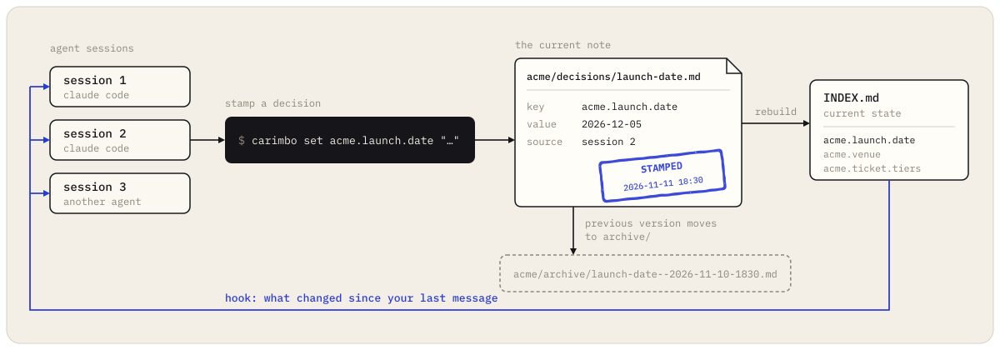

<p align="center">
  <picture>
    <source media="(prefers-color-scheme: dark)" srcset="assets/banner-dark.svg">
    
  </picture>
</p>

<p align="center">
  <a href="https://github.com/MarcoFanganielloBessa/carimbo/actions/workflows/ci.yml"></a>
  
  
  <a href="LICENSE"></a>
</p>

<p align="center"><a href="README.pt-BR.md">Leia em português</a></p>

**carimbo** (Portuguese for *rubber stamp*) is a shared memory for teams of AI agents that only keeps what was decided. Each decision is one Markdown note in a git repository, with who said it and when. When a decision changes, the new version is stamped and the old one moves to `archive/`. Every agent session starts from the same `INDEX.md`, and a hook tells each session what another one stamped while it was working.

It is a small Python package with no dependencies. The notes are plain Markdown you can open in Obsidian, and git does history and sync.

## Why

Run three Claude Code sessions and a couple of chat agents at the same time and the same thing keeps happening. Someone moves the launch from Monday to Tuesday in one chat. The session that is writing the landing page never hears about it and ships Monday. Chat history is per session, and the memory tools that record everything make it hard to tell which of five versions of a fact is the current one.

carimbo answers one question for every agent: **what is decided right now, who decided it, and what did it replace?** It does not try to remember everything. Conversations, research and drafts live elsewhere; only decisions, the status of each front and the questions waiting for a human get stamped.

We built it at [BOMA](https://www.instagram.com/weare_boma/), a music events company in São Paulo, where a team of agents and parallel coding sessions plans and sells our festivals. It has been our team's memory since October 2026.

## How it works

<p align="center"></p>

- **One note per key.** `acme.launch.date` lives in `acme/decisions/launch-date.md`. There is never a second copy to drift.
- **Replace, never edit.** `carimbo set` on an existing key moves the old note to `acme/archive/launch-date--2026-11-24-183000.md` and links the two, so the chain of changes is visible in git and in the Obsidian graph.
- **Who and when.** `--source` records who said it and when; `--discarded` records the options that lost and why, so nobody reopens them without a new fact.
- **One commit per stamp.** Writes are locked, pulled, committed and pushed, so several machines can share one vault through any git remote.
- **The index is generated.** `INDEX.md` (full) and `INDEX-SHORT.md` (one line per key, for small context windows) are rebuilt on every stamp.
- **Hooks keep sessions in sync.** At session start the agent receives the current state of its project. Before each prompt it receives only what other sessions stamped since its last message.
- **Personal data is refused.** Emails, phone numbers and ID numbers are rejected at write time and by a pre-commit hook, because the vault goes to remotes, servers and models.

## Quick start

```bash
uv tool install git+https://github.com/MarcoFanganielloBessa/carimbo   # or: pipx install git+https://...
carimbo init ~/carimbo --timezone America/Sao_Paulo
export CARIMBO_VAULT=~/carimbo
```

```bash
carimbo set acme.launch.date "Tickets go on sale Thursday 03/12 at 10:00." \
  --source "Ana in the launch call, 24/11 18:30" \
  --discarded "Friday 27/11: same day as the competitor's sale"

carimbo set acme.launch.date "Tickets go on sale Friday 04/12 at 10:00." --source "Ana, 25/11 09:10"
carimbo set acme.ads.budget "Raise the daily budget after the first sales report?" --type pending

carimbo show acme.
```

```
### Waiting for a decision
- `acme.ads.budget` (2026-11-25): Raise the daily budget after the first sales report?

### Decided
- `acme.launch.date` (2026-11-25): Tickets go on sale Friday 04/12 at 10:00. · source: Ana, 25/11 09:10
```

Add a remote (`git -C ~/carimbo remote add origin …`) and every stamp is pushed. A private repository is the right place for a real vault.

## Commands

| Command | What it does |
|---|---|
| `carimbo init [path] [--timezone TZ]` | Creates a vault: git repo, `carimbo.toml`, `agents/`, the pre-commit check |
| `carimbo set KEY TEXT [--type decision\|status\|pending] [--source S] [--discarded D] [--links k1,k2]` | Stamps a note; an existing one moves to `archive/` |
| `carimbo end KEY REASON` | Takes a key out of the current state, with the reason |
| `carimbo show [PREFIX] [--short]` | Current state, grouped as waiting, decided and status |
| `carimbo history KEY` | Every version of a key, oldest first |
| `carimbo approve` | Stamps a ` ```carimbo ` JSON block read from stdin (an agent proposes, a person approves) |
| `carimbo check [--staged] [FILES]` | Refuses personal data in notes; installed as the vault's pre-commit hook |
| `carimbo hook session-start\|prompt` | Claude Code hooks |
| `carimbo index` | Rebuilds `INDEX.md` and `INDEX-SHORT.md` |

Keys are `project.topic.subject` in lowercase. The first part is the top folder in the vault.

## A note on disk

```markdown
---
key: "acme.launch.date"
type: "decision"
date: "2026-11-25T09:10:12-03:00"
source: "Ana, 25/11 09:10"
discarded: ""
replaces: "[[launch-date--2026-11-24-183000]]"
links: ["acme.launch.venue"]
session: "b1f3…"
---
Tickets go on sale Friday 04/12 at 10:00.

---
**Source:** Ana, 25/11 09:10

**Replaces:** [[launch-date--2026-11-24-183000]]

Linked to: [[launch]] · [[launch-venue]]
```

Frontmatter is one JSON value per line, which is valid YAML, and carimbo also reads it back after Obsidian rewrites it. See [docs/note-format.md](docs/note-format.md) and the sample vault in [examples/vault](examples/vault).

## Plug it into your agents

- **Claude Code:** two hooks in `settings.json`. [docs/claude-code.md](docs/claude-code.md)
- **Codex, Cursor, OpenBot and any agent with a shell:** a short block in `AGENTS.md` or the system prompt. [docs/other-agents.md](docs/other-agents.md)
- **The archivist:** the rule that makes this work with many writers is that every page has one owner. Agents write freely in `agents/<name>/`; one archivist agent promotes what matters with `carimbo set` and resolves contradictions. Its manual, ready to paste: [docs/archivist.md](docs/archivist.md)

## Search across the whole vault

carimbo keeps the current state small enough to inject into every session. For full-text and semantic search over everything else in the same folder (meeting notes, research, agent inboxes), we pair it with [Open Second Brain](https://github.com/itechmeat/open-second-brain), which serves an Obsidian vault to agents over MCP. The two do not conflict: carimbo only writes inside project folders and the index files.

## Related projects

- [Open Second Brain](https://github.com/itechmeat/open-second-brain): Obsidian vault as agent memory, with MCP servers and a nightly pass that turns repeated corrections into preferences.
- [claude-mem](https://github.com/thedotmack/claude-mem): captures what an agent does in each session, compresses it and injects it back later.
- [Basic Memory](https://github.com/basicmachines-co/basic-memory): a local Markdown knowledge graph that agents read and write over MCP.
- [mem0](https://github.com/mem0ai/mem0) and [Letta](https://github.com/letta-ai/letta): memory layers and stateful agent platforms for applications.

Pick carimbo when the problem is several agents and people disagreeing about what was decided, and you want a record a human can read, diff and revert.

## Limits

- macOS and Linux (file locking uses `fcntl`).
- The hooks follow the Claude Code hook format; other agents read the state with `carimbo show`.
- The personal-data check is a set of regular expressions. It catches the common formats, and it is a safety net that does not replace judgment about what goes into a shared repository.

## Development

```bash
git clone https://github.com/MarcoFanganielloBessa/carimbo && cd carimbo
python3 -m unittest discover -s tests
```

Issues and pull requests are welcome. See [CONTRIBUTING.md](CONTRIBUTING.md).

## License

[MIT](LICENSE). Made by [BOMA](https://www.instagram.com/weare_boma/) in São Paulo.
