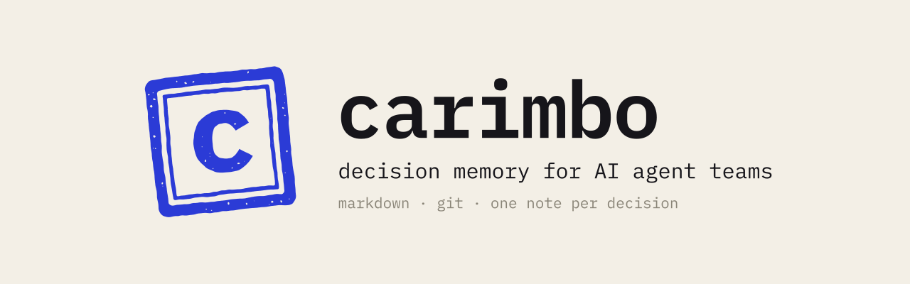
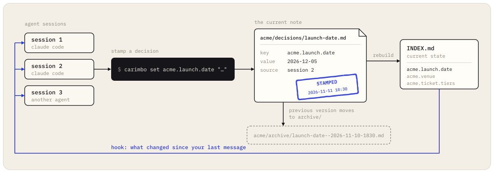

<p align="center">
  <picture>
    <source media="(prefers-color-scheme: dark)" srcset="assets/banner-dark.svg">
    
  </picture>
</p>

<p align="center"><a href="README.md">Read in English</a></p>

O **carimbo** é uma memória compartilhada para times de agentes de IA que guarda só o que foi decidido: uma nota em Markdown por decisão, numa pasta git, com quem disse e quando. Toda sessão de agente começa das decisões atuais e fica sabendo quando outra sessão muda alguma.

## Começar

Abra o Claude Code, o Codex, o Cursor ou qualquer agente que rode comandos no seu computador, na pasta de um projeto em que você trabalha, e cole:

```text
Instale o carimbo para mim. Baixe https://raw.githubusercontent.com/MarcoFanganielloBessa/carimbo/main/docs/agent-setup.md e siga passo a passo. Fale comigo em português.
```

O agente faz quatro perguntas numa mensagem só (onde fica o cofre, o seu fuso, qual pasta de projeto ligar e se você quer um remoto privado). Depois instala o carimbo com `uv` e cria o cofre. Antes de mexer nas configurações do seu agente, mostra cada mudança e espera o seu ok. Termina com um carimbo de teste e umas linhas sobre como vai trabalhar dali em diante. O arquivo que ele segue é o [docs/agent-setup.md](docs/agent-setup.md), se quiser ler antes.

Prefere fazer à mão: [Instalação manual](#instalação-manual).

## Como trabalhar no dia a dia

Você conversa como sempre. O agente carimba o que foi decidido e consulta quando você pergunta.

| Você diz | O agente |
|---|---|
| "Decidido: a venda abre sexta às 10h." | `carimbo set acme.launch.date "…" --source "você, 25/11"`, mais `--discarded` quando você diz o que perdeu |
| "Mudamos para sábado." | Carimba a mesma chave de novo; a versão de sexta vai para `archive/` |
| "Pergunta em aberto: subimos a verba de anúncio? Decido depois do primeiro relatório." | `carimbo set acme.ads.budget "…" --type pending` |
| "Sobe para 400 por dia." | Carimba `acme.ads.budget` de novo, agora como decisão |
| "Esquece a lista de imprensa, não vamos fazer." | `carimbo end acme.launch.press "não vamos fazer"` |
| "O que a gente decidiu sobre o lançamento?" | `carimbo show acme.launch.` e, para as mudanças no tempo, `carimbo history acme.launch.date` |

Uma sessão curta, numa pasta ligada ao projeto `acme`:

> **Você:** A Ana confirmou na call: a venda abre sexta 04/12 às 10h, não quinta, porque quinta bate com o outro festival.
>
> **Agente:** Carimbei `acme.launch.date`: "Venda abre sexta 04/12 às 10h." Fonte: Ana, call de lançamento, 25/11. Descartado: quinta 03/12, bate com o outro festival. A versão de quinta está no arquivo.
>
> **Você:** A gente sobe a verba de anúncio? Agora não, depois do primeiro relatório de vendas.
>
> **Agente:** Carimbei como pergunta esperando você: `acme.ads.budget`.

Enquanto isso, outra sessão do Claude Code, a que está fazendo a landing page, recebe isto antes da próxima mensagem, e você vê um aviso de uma linha (`carimbo: 1 change(s) from another session`):

```
Changed in the shared memory since your last message (another session stamped it):
- `acme.launch.date` (2026-11-25): Venda abre sexta 04/12 às 10h. · source: Ana, call de lançamento, 25/11
```

## Onde funciona

O carimbo é um programa de linha de comando mais dois hooks. Funciona em qualquer agente que rode comandos de shell na máquina onde está o cofre.

### Claude Code no terminal (CLI)

Instale ([quickstart](https://code.claude.com/docs/en/quickstart)), rode `claude` na pasta do projeto e cole o prompt. A instalação põe dois hooks no `~/.claude/settings.json`, que vale para todos os seus projetos ([hooks](https://code.claude.com/docs/en/hooks)). Depois, abra uma sessão nova para os hooks carregarem.

### Claude Code Desktop (a aba Code do app Claude)

Abra uma sessão local, escolha a pasta do projeto na linha embaixo da caixa de mensagem ([Desktop](https://code.claude.com/docs/en/desktop)) e cole o prompt. A documentação do Desktop diz que a chave `env` do `~/.claude/settings.json` vale para as sessões locais. Não achamos página que diga que o Desktop roda os hooks desse arquivo do mesmo jeito que o CLI, então confira uma vez: abra uma sessão nova na pasta ligada e pergunte "o que está decidido aqui?". A instalação grava os hooks com caminho absoluto, porque app de desktop nem sempre carrega o `PATH` do seu shell.

### VS Code e JetBrains

No VS Code, instale a extensão Claude Code (`anthropic.claude-code`), abra a pasta do projeto e cole o prompt no painel do Claude Code. A documentação dela diz que o `~/.claude/settings.json`, com os hooks, é o mesmo da extensão e do CLI ([VS Code](https://code.claude.com/docs/en/vs-code)). O plugin do JetBrains roda o `claude` no terminal da IDE, então vale tudo o que está acima para o CLI ([JetBrains](https://code.claude.com/docs/en/jetbrains)).

### Claude Code na web (claude.ai/code)

Não funciona hoje. As sessões rodam numa máquina na nuvem que clona o seu repositório do GitHub e não enxerga o cofre do seu computador ([documentação](https://code.claude.com/docs/en/claude-code-on-the-web)). A instalação detecta isso (`CLAUDE_CODE_REMOTE=true`) e para.

### App Claude ou claude.ai, sem o Claude Code

Não funciona. O chat não roda comando de shell nem hook, e o carimbo não tem servidor MCP.

### Codex CLI

Instale ([openai/codex](https://github.com/openai/codex)), rode `codex` na pasta do projeto e cole o prompt. O Codex lê o `AGENTS.md` de `~/.codex` e da raiz do projeto até a pasta de trabalho ([AGENTS.md](https://developers.openai.com/codex/guides/agents-md)); a instalação grava as regras ali, e o agente roda `carimbo show` no começo de cada tarefa. O Codex também tem hooks `SessionStart` e `UserPromptSubmit` no mesmo formato de saída do Claude Code ([hooks](https://developers.openai.com/codex/hooks)), mas o carimbo ainda não foi testado com eles, e a instalação não mexe neles.

### Cursor

Abra o projeto e cole o prompt no chat do agente. O Cursor lê o `AGENTS.md` da raiz do projeto ([rules](https://cursor.com/docs/context/rules)), e é ali que a instalação põe as regras. Os hooks do Cursor usam outro formato ([hooks](https://cursor.com/docs/agent/hooks)), que o carimbo não fala, e as mudanças de outras sessões só chegam quando o agente roda `carimbo show`.

### Qualquer outro agente com shell

Aider, um bot num servidor, seus scripts: as mesmas regras vão nas instruções ou no prompt de sistema dele. Veja [docs/other-agents.md](docs/other-agents.md).

## Por quê

Rode três sessões do Claude Code e uns agentes de chat ao mesmo tempo e a mesma coisa acontece sempre. Alguém muda o lançamento de quinta para sexta num chat. A sessão que está fazendo a landing page nunca fica sabendo e publica quinta. O histórico de chat é de cada sessão, e as ferramentas de memória que gravam tudo deixam difícil saber qual das cinco versões de um fato vale agora.

O carimbo responde uma pergunta para todo agente: **o que está decidido agora, quem decidiu e o que isso substituiu?** Ele não tenta lembrar de tudo. Conversa, pesquisa e rascunho ficam em outro lugar; só entram decisões, a situação de cada frente e as perguntas que esperam uma pessoa.

Nasceu na [BOMA](https://www.instagram.com/weare_boma/), empresa de eventos de música de São Paulo, onde um time de agentes e várias sessões de código em paralelo planejam e vendem os nossos festivais. É a memória do nosso time desde outubro de 2026.

## Como funciona

É um pacote Python pequeno, sem dependências. As notas são Markdown puro, que abre no Obsidian, e o git cuida do histórico e da sincronização.

<p align="center"></p>

- **Uma nota por chave.** `acme.launch.date` mora em `acme/decisions/launch-date.md`. Nunca existe uma segunda cópia para divergir.
- **Substitui, não edita.** `carimbo set` numa chave que já existe move a nota antiga para `acme/archive/launch-date--2026-11-24-183000.md` e liga as duas; a cadeia de mudanças aparece no git e no grafo do Obsidian.
- **Quem e quando.** `--source` grava quem disse e quando; `--discarded` grava as opções que perderam e por quê, para ninguém reabrir sem fato novo.
- **Um commit por carimbo.** A gravação trava, puxa, faz o commit e o push; várias máquinas dividem o mesmo cofre por qualquer remoto git.
- **O índice é gerado.** `INDEX.md` (completo) e `INDEX-SHORT.md` (uma linha por chave, para contexto pequeno) são refeitos a cada carimbo.
- **Os hooks sincronizam as sessões.** Ao abrir, o agente recebe o estado atual do projeto dele. Antes de cada mensagem, recebe só o que outras sessões carimbaram desde a última.
- **Dado pessoal é recusado.** E-mail, telefone e CPF são barrados na gravação e por um hook de pre-commit, porque o cofre vai para remotos, servidores e modelos.

## Instalação manual

```bash
uv tool install git+https://github.com/MarcoFanganielloBessa/carimbo   # ou: pipx install git+https://...
carimbo init ~/carimbo --timezone America/Sao_Paulo
export CARIMBO_VAULT=~/carimbo
```

```bash
carimbo set acme.launch.date "Venda abre quinta 03/12 às 10h." \
  --source "Ana na call de lançamento, 24/11 18h30" \
  --discarded "sexta 27/11: mesmo dia da venda do concorrente"

carimbo set acme.launch.date "Venda abre sexta 04/12 às 10h." --source "Ana, 25/11 09h10"
carimbo set acme.ads.budget "Subir a verba diária depois do primeiro relatório de vendas?" --type pending

carimbo show acme.
```

```
### Waiting for a decision
- `acme.ads.budget` (2026-11-25): Subir a verba diária depois do primeiro relatório de vendas?

### Decided
- `acme.launch.date` (2026-11-25): Venda abre sexta 04/12 às 10h. · source: Ana, 25/11 09h10
```

Com um remoto (`git -C ~/carimbo remote add origin …`), cada carimbo sobe sozinho. Para um cofre de verdade, use um repositório privado.

Depois, ligue os agentes à mão: [docs/claude-code.md](docs/claude-code.md) para os hooks do Claude Code, [docs/other-agents.md](docs/other-agents.md) para o resto.

## Comandos

| Comando | O que faz |
|---|---|
| `carimbo init [pasta] [--timezone TZ]` | Cria o cofre: repo git, `carimbo.toml`, `agents/` e a checagem de pre-commit |
| `carimbo set CHAVE TEXTO [--type decision\|status\|pending] [--source S] [--discarded D] [--links k1,k2]` | Carimba uma nota; a anterior vai para `archive/` |
| `carimbo end CHAVE MOTIVO` | Tira a chave do estado atual, com o motivo |
| `carimbo show [PREFIXO] [--short]` | Estado atual: esperando, decidido e situação |
| `carimbo history CHAVE` | Todas as versões de uma chave, da mais antiga para a mais nova |
| `carimbo approve` | Carimba um bloco JSON ` ```carimbo ` lido do stdin (o agente propõe, a pessoa aprova) |
| `carimbo check [--staged] [ARQUIVOS]` | Recusa dado pessoal nas notas; instalado como pre-commit do cofre |
| `carimbo hook session-start\|prompt` | Hooks do Claude Code |
| `carimbo index` | Refaz `INDEX.md` e `INDEX-SHORT.md` |

A chave é `projeto.tema.assunto`, em minúsculas. A primeira parte é a pasta do projeto no cofre.

## Muitos agentes escrevendo

Com um time de agentes escrevendo ao mesmo tempo, dê um dono só a cada página. Os agentes escrevem livre em `agents/<nome>/`; um agente arquivista promove o que importa com `carimbo set` e resolve contradição. O manual dele, pronto para colar: [docs/archivist.md](docs/archivist.md).

O formato das notas e das pastas está em [docs/note-format.md](docs/note-format.md), e um cofre de exemplo em [examples/vault](examples/vault).

## Busca no cofre inteiro

O carimbo mantém o estado atual pequeno o bastante para entrar em toda sessão. Para busca de texto e semântica no resto da mesma pasta (atas, pesquisa, anotações dos agentes), usamos junto o [Open Second Brain](https://github.com/itechmeat/open-second-brain), que serve um cofre do Obsidian para agentes por MCP. Os dois convivem: o carimbo só escreve nas pastas de projeto e nos índices.

## Projetos parecidos

- [Open Second Brain](https://github.com/itechmeat/open-second-brain): cofre do Obsidian como memória de agente, com servidores MCP e uma passada noturna que transforma correções repetidas em preferências.
- [claude-mem](https://github.com/thedotmack/claude-mem): grava o que o agente faz em cada sessão, comprime e devolve depois.
- [Basic Memory](https://github.com/basicmachines-co/basic-memory): grafo de conhecimento local em Markdown que agentes leem e escrevem por MCP.
- [mem0](https://github.com/mem0ai/mem0) e [Letta](https://github.com/letta-ai/letta): camadas de memória e plataformas de agentes com estado para aplicações.

Use o carimbo quando o problema é agentes e pessoas discordando do que foi decidido, e você quer um registro que uma pessoa lê, compara e desfaz.

## Limites

- macOS e Linux (a trava de arquivo usa `fcntl`).
- Os hooks seguem o formato do Claude Code; os outros agentes leem o estado com `carimbo show`.
- A checagem de dado pessoal é feita com expressões regulares. Pega os formatos comuns e serve de rede de proteção; o critério sobre o que entra num repositório compartilhado continua sendo de quem grava.

## Desenvolvimento

```bash
git clone https://github.com/MarcoFanganielloBessa/carimbo && cd carimbo
python3 -m unittest discover -s tests
```

Issues e pull requests são bem-vindos. Veja [CONTRIBUTING.md](CONTRIBUTING.md).

## Licença

[MIT](LICENSE). Feito pela [BOMA](https://www.instagram.com/weare_boma/) em São Paulo.
